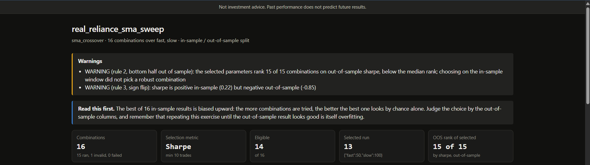
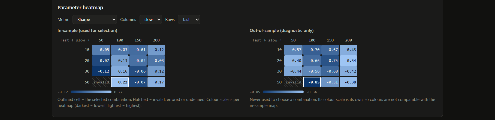
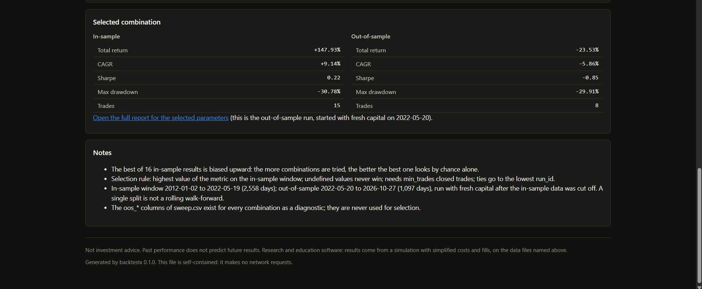

# BacktestX

An event-driven backtesting engine in C++17 for Indian equities (NSE). Daily bars, exact integer-paise accounting, an NSE delivery
cost model, five built-in strategies, a command-line interface, parameter sweeps with an out-of-sample split and overfitting warnings,
and a self-contained HTML report.



*Sweep report on RELIANCE.NS — the in-sample best parameters ranked last (15/15) out-of-sample*

Open `examples/sma_crossover/report.html` and `examples/sma_sweep/report.html` in a browser to see reports built from the
synthetic sample data (the RELIANCE report above is built from Yahoo data, which is not shipped; see the case study below).

**Not investment advice. Past performance does not predict future results.**
This is research / education software. Results come from a simulation with simplified costs and fills.

## Features

- **Event-driven engine.** One loop per trading day: fill pending orders at the open, mark to market, call the strategy with the
  data up to today's close, collect its orders. Market, stop and limit orders, day or good-till-cancelled.
- **Look-ahead is impossible by construction**, not by discipline: a strategy only sees data through a bounds-checked `HistoryView`, and a test
  replaces every bar after day *t* with garbage and checks that nothing decided on or before day *t* changes.
- **Exact money.** Cash, fills, fees and P&L are `int64` paise; fee rates are integer parts-per-billion with defined rounding; no floating-point
  drift in the ledger.
- **NSE delivery cost model** (STT, exchange charges, SEBI fee, stamp duty, GST, optional brokerage) and fixed-bps slippage.
- **Strategies:** buy-and-hold, SMA crossover, RSI mean reversion, Donchian breakout with ATR stop, momentum rotation across a universe.
- **Analytics** with every formula written down (CAGR, volatility, Sharpe, Sortino, drawdowns, Calmar, trade statistics, turnover, beta/alpha
  against a benchmark), cross-checked against an independent pure-Python implementation.
- **Parameter sweeps** run on a thread pool with bit-identical results at any thread count, a single in-sample / out-of-sample split, and
  heuristic overfitting warnings that say which rule fired.
- **HTML report**: one file, no network, with equity curve (log toggle), drawdown, monthly returns, trades, fee breakdown, and for sweeps a
  parameter heatmap and an in-sample vs out-of-sample table.
- **Tested** with unit tests, a look-ahead test, a differential test against Python, and hand-written mutation testing (`tools/mutate.py`).

## Architecture

```
  CSV files                                                    config (JSON)
     |                                                              |
     v                                                              v
 DataFeed:  csv loader -> adjust prices -> union calendar ---> RunConfig (strict parser)
            (strict, line-numbered errors)   (AlignedData + HistoryView)
     |
     v
  +---------------------------- Engine: one loop per trading day ----------------------------+
  |  1. fill pending orders  ->  Broker sim (fills, slippage, costs)  ->  Portfolio (cash, positions) |
  |  2. mark to market, record equity                                                        |
  |  3. Strategy::on_bar(Context, HistoryView)   -- sees data up to today's close only        |
  |  4. collect the Orders it staged for the next open                                       |
  +------------------------------------------------------------------------------------------+
     |  equity curve, fills, trades
     v
 Analytics (metrics, benchmark stats)  ->  export: equity.csv trades.csv fills.csv summary.json run.json
     |                                                          |
     |                                          Sweep: grid -> thread pool -> select on in-sample -> out-of-sample run
     v                                                          v
 Report (report.html, built from the exported files)       sweep.csv, sweep_summary.json, best/
```

See `ARCHITECTURE.md` for the file map, the life of one bar, why look-ahead is impossible and how sweeps use threads.

## Build (Windows, portable toolchain)

```powershell
.\build.ps1          # configure + Release build + unit tests + metrics cross-check + CLI smoke + Python tool tests
.\build.ps1 -Clean   # wipe build\ first
```

The script puts `D:\Tools\w64devkit\bin` and `D:\Tools\cmake\bin` on PATH for its own process only.

## Quick start

```powershell
.\build\backtestx.exe run   --config configs\sma.json       --out results\sma        # one backtest
.\build\backtestx.exe sweep --config configs\sma_sweep.json --out results\sweep      # parameter grid + out-of-sample split
.\build\backtestx.exe sweep --config configs\sma_sweep.json --out results\sweep --threads 4
```

The sample configs run offline on the synthetic files in `data\sample\`. For real NSE data:
`python tools\fetch_data.py` (downloads into `data\`; Yahoo's terms restrict redistribution, so it is for your own research).

### A run folder

| File | Content |
|---|---|
| `summary.json` | **exactly** the analytics: `config` + `equity` + `trades` + `benchmark` blocks (all metrics defined in LEARNING.md) |
| `equity.csv`, `trades.csv`, `fills.csv`, `benchmark.csv` | the exported rows (exact integer paise); the Python reference recomputes every metric from these |
| `report.html` | the self-contained HTML report (see HTML report below) |
| `run.json` | everything else: the fully resolved config, files loaded (bars, dates, excluded dates, largest move), the evaluation window and warm-up, order counts, warnings |

A sweep folder has `sweep.csv` (one row per combination), `sweep_summary.json` (selection, windows, warnings, notes) and `best\`
(a complete run folder for the selected parameters), plus `report.html` (and `best/report.html`).

## The run config (strict: unknown keys and wrong types are errors that name the key path)

```json
{
  "data": { "dir": "../data", "files": ["RELIANCE.NS", "TCS.NS"], "prices": "adjusted", "null_rows": "skip",
            "exclude_dates": { "NIFTYBEES.NS": ["2019-12-19", "2019-12-20"] } },
  "period": { "start": "2015-01-01", "end": "2024-12-31" },
  "capital": 1000000,
  "costs_file": "costs_nse_delivery.json",
  "slippage": { "mode": "fixed_bps", "value": 5 },
  "sizing": { "allocation": 0.95 },
  "strategy": { "name": "sma_crossover", "params": { "symbol": "RELIANCE.NS", "fast": 20, "slow": 50 } },
  "benchmark": "NIFTYBEES.NS"
}
```

Paths are relative to the config file. `prices` defaults to **adjusted**. `sizing.allocation` is the only place allocation can be
set (setting it in `strategy.params` is an error). Strategies: `buy_and_hold`, `sma_crossover`, `rsi_mean_reversion`,
`donchian_breakout`, `momentum_rotation` (parameters and rules: LEARNING.md, Phase 3). The full reference is written in Phase 8.

### Evaluation window and warm-up

`period.start` / `period.end` define the evaluation window. History **before** `start` is loaded as warm-up: strategies run on it so their
indicators are ready, but **nothing counts**: every order placed during warm-up is discarded, the portfolio stays at the initial
capital, and the equity curve (and therefore every metric) begins on the start date. The same rule applies to every strategy, so all
strategies get the same window and are ready on day 1. The first decision that counts is made at the close of the first evaluation
day (it fills the next day). With no `start`, strategies warm up *inside* the window and sit in cash at first (a warning says so).

### Benchmark

The default benchmark is **NIFTYBEES.NS** (adjusted), used when the `benchmark` key is absent; a missing file is an error.
`"benchmark": "^NSEI"` selects the index and `"benchmark": null` means none. Why not the index: `^NSEI` is a **price** index (no
dividends) while adjusted stock prices include dividends, so alpha against it is biased upward by roughly the dividend yield. NIFTYBEES,
an ETF on the Nifty 50, carries the fund's accumulated income and is a **proxy** for a total-return benchmark, not an exact one: it has
an expense ratio (not quantified here) and tracking error. Measured on the downloaded files (one-off script, see `data\README.md`),
after excluding four corrupted closes it differs from `^NSEI` by +0.85 %/yr in CAGR with a 5 % annualised tracking error and 0.95
daily correlation. Yahoo applies **no** dividend adjustment to this ETF (`Adj Close` equals `Close`), and the file contains bad ticks, so
the run refuses implausible moves (`max_daily_move`; 0.15 for the benchmark, 0.5 for traded symbols) and bad bars must be listed in
`data.exclude_dates` (the CSV is never edited; every excluded date must exist in the file). The exclusion list cannot be exhaustive.

### Sweeps and overfitting guards

```json
"sweep": { "grid": { "fast": [5, 10, 20], "slow": { "start": 30, "stop": 100, "step": 10 } },
           "metric": "sharpe", "min_trades": 10, "walk_forward": { "in_sample_fraction": 0.7 } }
```

Every grid point is an independent, deterministic run over the same read-only data; they run on a thread pool
(`hardware_concurrency` by default, `--threads N` to change) and the results are identical for any thread count. Guards: an
**out-of-sample split** (the in-sample data physically ends at the split; selection sees only in-sample numbers; the out-of-sample
run starts with fresh capital and uses earlier history only as warm-up); a **minimum trade count**; undefined metrics are never
selected; ties go to the first combination; the number of combinations tried is reported; and **warnings** (heuristics; each message says which rule fired): rule 1, in-sample Sharpe at least 0.5 but out-of-sample Sharpe
below half of it; rule 2, the selected parameters rank in the bottom half out of sample on the selection metric; rule 3, the selection
metric is positive in-sample but negative out of sample. This is a single split, not a rolling walk-forward, and the best of
N in-sample results is biased upward whatever the split.

## Data utilities

```powershell
.\build\backtestx.exe check data\sample\SYNTH_A.csv              # validate a CSV
.\build\backtestx.exe check data\NSEI.csv --skip-null --adjust   # real Yahoo files contain null rows
.\build\backtestx.exe synth --out data\sample\X.csv --seed 1 --bars 500
python tools\fetch_data.py                                       # RELIANCE/TCS/HDFCBANK/INFY, ^NSEI and NIFTYBEES.NS
```

`data\sample\` holds **synthetic** files only. Downloaded Yahoo data is for your own research; do not redistribute it.

## Getting the data

Real data is not shipped (Yahoo's terms restrict redistribution). The repository contains **synthetic** sample files in `data/sample/`
that every test and example config uses, so everything builds and runs offline.

To research on real NSE data, download it yourself with the standard-library-only script:

```powershell
python tools\fetch_data.py                                   # RELIANCE, TCS, HDFCBANK, INFY, ^NSEI and NIFTYBEES.NS -> data\
python tools\fetch_data.py --symbols TCS.NS --start 2015-01-01 --out data
```

- It calls Yahoo Finance's unofficial chart endpoint (undocumented; it can change or rate-limit without notice) and writes
  `Date,Open,High,Low,Close,Adj Close,Volume` CSV files. A leading `^` is dropped in file names (`^NSEI` becomes `NSEI.csv`).
- Before 15:30 IST it drops a row dated "today" (an unfinished bar).
- Yahoo returns some all-`null` rows; the loader rejects them by default, so real-data configs set `"null_rows": "skip"`.
- The default benchmark `NIFTYBEES.NS` has four known-bad closes (see `data/README.md` and `tools/analysis/known_bad_bars.json`);
  real-data configs exclude them with `data.exclude_dates`. Do not assume other files are clean: run
  `python tools\analysis\data_quality.py` and read `data/README.md`.
- Downloaded files are ignored by `.gitignore`. They are for your own research only.

## Cost model

Applied to every fill (rates are in `configs/costs_nse_delivery.json`, which also records sources and how well each rate was verified):

| charge | rate in the default file |
|---|---|
| brokerage | Rs 0 (an assumption about a discount broker); `costs_nse_delivery_flat20.json` uses Rs 20 per fill |
| STT (securities transaction tax), delivery | 0.1% on buy and on sell |
| exchange transaction charge | 0.00307% of turnover |
| SEBI turnover fee | 0.0001% of turnover (Rs 10 per crore) |
| stamp duty | 0.015% on the buy side |
| GST | 18% of (brokerage + exchange charge + SEBI fee) |

Percent charges are computed in integer paise with ties rounded away from zero; GST is computed on the rounded sum of its base charges.
Slippage is optional (`"slippage": {"mode": "fixed_bps", "value": 5}`). **Cost rates change and the file reflects one regime (2026 rates)**:
using it for 2010-2026 backtests is only roughly cost-realistic. Check the current rates with your broker before relying on any figure.

## Assumptions and limitations

- **One cost regime for all history.** The cost model applies the 2026 rate set (STT, exchange charges, SEBI fee,
  stamp duty, GST) to every date in a backtest, e.g. 2010-2026. Earlier regimes differed (for example stamp duty
  was set by each state before 2020-07-01, and exchange charges and fees have changed over the years), so
  long-history results are only roughly cost-realistic.
- **Brokerage default is Rs 0** (`configs/costs_nse_delivery.json`), an assumption about a discount broker.
  `configs/costs_nse_delivery_flat20.json` charges Rs 20 per fill for a more conservative run.
- Cost rates change and some are only partly verified; each config file records its sources and evidence level.
- **Survivorship bias / delisted holdings.** The engine can only trade a symbol on days it has a bar. A position in a
  symbol whose data simply ends (a delisting, merger or suspension) is marked at its last close forever and cannot be
  sold, so its value is stuck, any cash needed for a replacement purchase is missing (the buy is rejected for cash), and
  the backtest ignores what really happened to the shares. More broadly, a universe made of today's index members
  silently excludes every company that failed or was removed, which flatters results. Choose universes with this in mind.
- **Adjusted prices are the backtest default**: they remove the fake price drop on ex-dividend days, but an adjusted price is
  not a price you could have traded at, so notionals, share counts and the percentage fees computed from them are on adjusted
  rupees (fees on old trades are slightly understated).
- **The benchmark is a proxy** (see above): NIFTYBEES is noisy relative to the index, and Yahoo data for it contains bad ticks.
- **Daily bars only.** No intraday data; the engine, calendar and annualisation (252 trading days) assume one bar per day, and orders
  fill at the next open.
- **Dividends and corporate actions** appear only through adjusted prices (`Adj Close`); raw-price mode ignores them. The data files hold no
  fundamentals, no delisting information and no NSE holiday calendar (the calendar is the union of the loaded files' dates).
- **Fills are simulated:** no order book, no market impact beyond fixed slippage, optional volume-participation cap, no partial fills of a
  day's range beyond that.
- **The benchmark default is a proxy** (see above) and the cost rates may be outdated.
- **Overfitting is reduced, not removed.** A parameter sweep tests many combinations; even with an out-of-sample split, repeating
  the exercise until the out-of-sample result looks good is itself overfitting.

## HTML report

`backtestx run` and `backtestx sweep` write `report.html` next to the CSV/JSON files; `backtestx report --dir DIR` regenerates it from a
finished folder. It is a single self-contained file (inline CSS, JS and SVG; no CDN, no network), dark theme, rupee amounts with Indian
digit grouping (1,23,45,678), monospace right-aligned numbers.

- **Run report:** metrics table (strategy vs benchmark), equity curve vs benchmark with a linear/log toggle, drawdown chart, monthly returns
  heatmap with yearly totals, trade list (sortable, open positions listed), fee breakdown, the configuration used, warnings, disclaimer.
- **Sweep report:** parameter heatmap (any metric, any pair of parameters; other parameters held at the selected values), in-sample vs
  out-of-sample table sorted by the in-sample metric, the selected combination with a link to `best/report.html`, warnings, and a
  prominent note that the best of N in-sample results is biased upward.
- **Built from the folder, not from memory:** the report reads the exported files, so it cannot disagree with them. Every number in it is
  computed in C++ (`src/report.cpp`) and embedded as JSON; the JavaScript only formats and draws.
- **Paths:** directories are shortened to file names in the report; full paths stay in `run.json`.
- **If the report fails** to write, the data files are kept and the command exits 1.

Examples built from the synthetic sample data (regenerate with `tools/make_examples.ps1`, which also proves the bytes are reproducible):
`examples/sma_crossover/report.html`, `examples/sma_sweep/report.html` and `examples/sma_sweep/best/report.html`.
They show the report layout only; the sample data is synthetic and says nothing about real markets.

Not investment advice. Past performance does not predict future results.

## Benchmarks

`docs/BENCHMARKS.md` holds the measured throughput of the engine and of the sweep thread pool (three runs, environment, method, guards,
scaling table and explanation). It is generated: `.\build.ps1` then `.\tools\run_benchmarks.ps1` (leave the machine idle). The numbers are
for one machine on synthetic data and are not a comparison with anything.

## Case study: overfitting on RELIANCE

One stock, one parameter search, one split. It is here to show the mechanism, not to say anything about RELIANCE or about SMA strategies.

`tools/analysis/real_sweep_example.py` sweeps `sma_crossover` on RELIANCE.NS (adjusted prices, Rs 10 lakh start, 95% allocation) over
fast {10, 20, 30, 50} x slow {50, 100, 150, 200}, picks the combination with the best Sharpe ratio on the first 70% of the history
(minimum 10 trades), then runs it on the remaining 30% with fresh capital. The benchmark is NIFTYBEES.NS (a proxy; four bad closes
excluded). The table below is the script's own `--markdown` output (it needs the real data files, so it is not reproducible from a fresh clone):

```
python tools\analysis\real_sweep_example.py            # runs the sweep, writes examples\real_reliance_sweep\ (gitignored)
python tools\analysis\real_sweep_example.py --markdown # prints this table from that folder
```

Selected in-sample on sharpe: fast 50, slow 100 (1 of 16 combinations; 14 eligible).

| window | days | Sharpe | CAGR | total return | max drawdown | trades |
|---|---:|---:|---:|---:|---:|---:|
| in-sample 2012-01-02 to 2022-05-19 | 2558 | 0.222 | 9.14% | 147.93% | -30.78% | 15 |
| out-of-sample 2022-05-20 to 2026-10-27 | 1097 | -0.850 | -5.86% | -23.53% | -29.91% | 8 |

- Out-of-sample sharpe of the selected parameters ranks 15 of 15 combinations.
- Over the same out-of-sample window NIFTYBEES.NS returned 47.50% against the strategy's -23.53%.
- WARNING (rule 2, bottom half out of sample): the selected parameters rank 15 of 15 combinations on out-of-sample sharpe, below the median rank; choosing on the in-sample window did not pick a robust combination
- WARNING (rule 3, sign flip): sharpe is positive in-sample (0.22) but negative out-of-sample (-0.85)

The parameter heatmaps from the same report (Sharpe, in-sample on the left and out-of-sample on the right; the outlined cell is the
combination selected in-sample; each map has its own colour scale):



The selected combination's in-sample and out-of-sample figures, as the report shows them:



What this shows: the combination that looked best in-sample (modest Sharpe 0.222, positive return) lost money out of sample and ranked last of
15 combinations there, while the benchmark proxy rose. Choosing the best of N on the same data you report on flatters the result; the
out-of-sample window exists to catch that, and repeating the exercise until the out-of-sample number looks good would be overfitting again.
The first version of the overfit warning (in-sample Sharpe >= 0.5 and out-of-sample Sharpe below half of it) **did not fire** here, because the
in-sample Sharpe was below its 0.5 floor; that gap is why rules 2 (bottom half out of sample) and 3 (sign flip) were added.
Caveats: one stock, one split, one grid, and a proxy benchmark.

## Future work

Things this engine deliberately does not do yet, in the order I would add them:

- **Rolling walk-forward optimisation.** Today a sweep has one in-sample / out-of-sample split. Walk-forward would re-select
  parameters on a sliding in-sample window and trade the next out-of-sample slice, then stitch the slices into one out-of-sample curve.
- **A survivorship-free universe.** Point-in-time index membership and delisted symbols' real histories, so a backtest does not only
  see today's survivors (see Limitations).
- **Intraday bars.** The event loop, calendar and analytics assume one bar per trading day (annualisation by 252, daily fills at the next open).
- **Corporate-action-aware raw data.** Trade on raw prices and apply splits, bonuses and dividends as explicit events (share counts,
  cash credits), instead of the adjusted-price approximation described above.

## Testing

```powershell
.\build.ps1                          # unit tests + metrics differential check + CLI smoke + Python tool tests
python tools\mutate.py --list        # list the hand-written mutations (tools\mutations.json)
python tools\mutate.py               # run ALL mutations: patch, rebuild, run tests, report caught / survived, restore
python tools\mutate.py --only SW1 DS4 --verbose
.\tools\realdata_check.ps1           # optional: all strategies on the real files vs the default benchmark, through ref_metrics.py
.\tools\realdata_check.ps1 -Benchmark '^NSEI'
```

### Metrics cross-check

`build.ps1` runs `tools\ref_metrics.py`: a pure-Python (no numpy) re-computation of every performance metric from the exported
`equity.csv` / `trades.csv` / `fills.csv` / `benchmark.csv`, compared with the C++ `summary.json` of 13 scenarios (integers, dates
and key sets exactly; floats within 1e-9 relative). It fails if the folder is empty, so a stale export cannot pass. It then
re-checks the outputs of the real CLI on the shipped sample configs (one run, one sweep). `tools\test_ref_metrics.py` checks the
Python reference itself against hand-computed values and tampered exports.

`tools\realdata_check.ps1` is **optional and not part of `build.ps1`**: it needs the real files from `fetch_data.py`. With none of
them present it prints `SKIPPED` and exits 0; with only some present it fails. It is a consistency check (engine, exporters and the
Python reference agree on real data), not evidence about strategy quality.

### Report checks

`build.ps1` runs `tools/check_report.py` on the smoke runs: it re-derives the embedded drawdown, monthly and yearly returns, fee totals,
trade rows, open positions and the rebased benchmark (its metrics via `tools/ref_metrics.py`) from the CSV files and compares them with
the report, plus static checks (disclaimer present, no external reference, no raw `<` inside the embedded data). `tools/test_report_js.js`
(Node, skipped if absent) tests the rupee/percent formatting; `tools/browser_check.py` opens the reports in headless Edge/Chrome (skipped
if absent) and checks that the page drew itself without an error; `--shots DIR` also saves screenshots to look at. The JavaScript is not
mutation-tested.

### Data analysis scripts

`tools\analysis\` holds the scripts that produce every figure quoted about the real data (data quality, NIFTYBEES as a benchmark proxy,
raw vs adjusted signals, benchmark effect on alpha). The rule is that a number in a report or in `LEARNING.md` must come from one of them.
They skip cleanly without the real files; `python -I tools\test_analysis.py` (part of `build.ps1`) tests their logic on synthetic data.
See `tools\analysis\README.md`.

### Mutation testing

`tools\mutate.py` (standard library only) breaks the source in specific, deliberate ways (flip a comparison, shift an
off-by-one, ...) and checks that the test suite notices each one. It is **not** part of `build.ps1` because it rebuilds once
per mutation (roughly 30-40 seconds each). A result is *not* a coverage measurement: it only shows that these particular bugs
are detected. A survivor is either a test gap or an "equivalent mutant" (the change cannot alter behaviour; those are marked
`expect: equivalent` in the data file). The tool saves each file before patching it, restores it afterwards (and after a
killed run), and checks hashes at the end, because the project has no version control.
